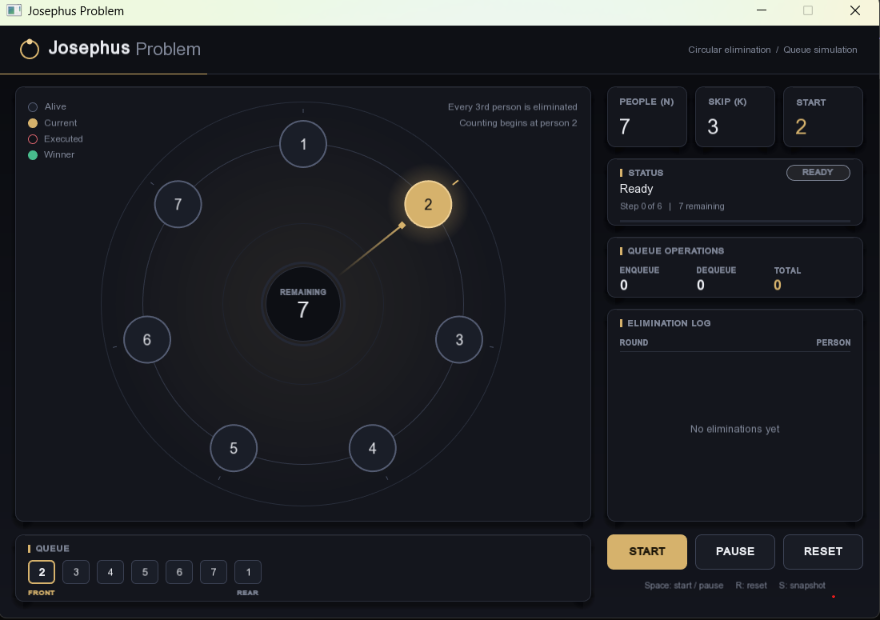
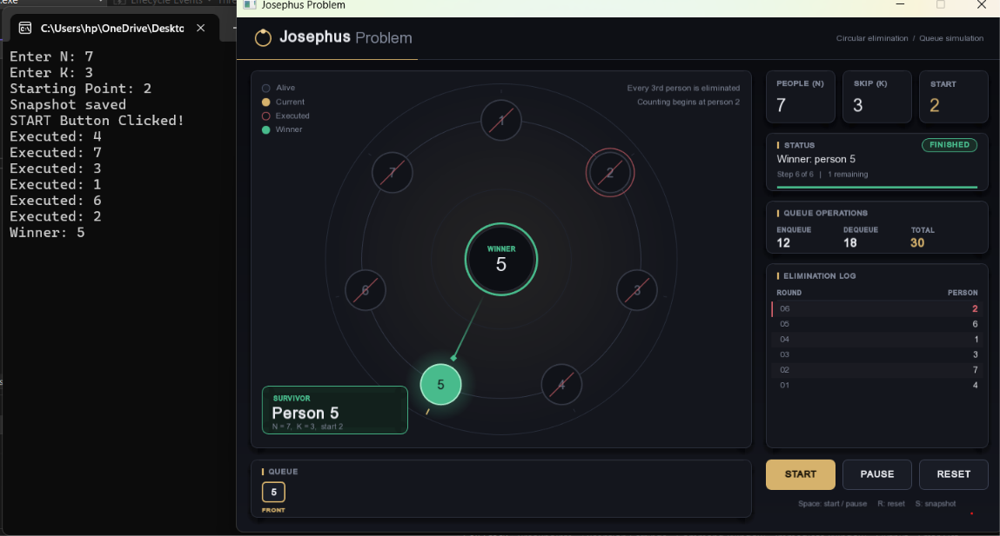

# Josephus Problem Visualizer

An interactive **C++ and SFML** visualization of the Josephus problem, powered by a custom, dynamically resizing **circular queue**. Watch participants being counted and eliminated until one survivor remains.

## About the Problem

The Josephus problem places **N people** in a circle and eliminates every **K-th person**, continuing from the next remaining participant until only one is left.

This program randomly selects the initial counting position, animates the elimination process, and shows how queue operations implement circular counting.

## Features

- Circular arena with numbered participants and an animated pointer.
- Dark interface with gold highlights, rounded panels, and hover effects.
- Counting sweeps, elimination animations, and a highlighted survivor.
- Live queue view with front and rear indicators when the entire queue is visible.
- Participant count, elimination interval, and starting-position indicators.
- Ready, running, paused, and finished states.
- Progress ring, remaining-participant count, and elimination log.
- Enqueue, dequeue, and total-operation counters for simulation steps.
- Start, Pause, and Reset buttons with keyboard shortcuts.
- PNG snapshots and participant hover tooltips.

The window is **1100 × 740**, rendering is capped at **60 FPS**, and an elimination step runs approximately once per second while the simulation is active.

## Project Preview

### Graphical Interface



### Survivor display



## Demo Video

https://github.com/user-attachments/assets/f2e51cf0-7d8e-44a6-8394-a1e0e7b5c9a7


## Requirements

- Visual Studio with the **Desktop development with C++** workload.
- **SFML 2.x**, including the Graphics, Window, and System modules. The current source uses the SFML 2 API.
- An SFML build compatible with the project's compiler, platform, and build configuration.
- A font at one of the paths checked by the source:

```text
Windows: C:/Windows/Fonts/arial.ttf
macOS:   /System/Library/Fonts/Supplemental/Arial.ttf
Linux:   /usr/share/fonts/truetype/dejavu/DejaVuSans.ttf
```

The application tries these paths in order and exits if none loads. Update the font path in `josephus.cpp` if necessary.

## Build and Run

The repository includes an existing Visual Studio solution and project settings.

1. Clone or download the repository.
2. Open **SFML TEST.sln** in Visual Studio.
3. If prompted, retarget the solution to an installed Windows SDK and C++ toolset.
4. Select a build configuration and platform matching your SFML installation.
5. If the saved SFML paths differ from your local installation, open **Project Properties** and update:
   - **C/C++ → General → Additional Include Directories:** your SFML `include` folder.
   - **Linker → General → Additional Library Directories:** your SFML `lib` folder.
   - **Linker → Input → Additional Dependencies:** the SFML Graphics, Window, and System libraries matching your configuration. Dynamic Release builds normally use `sfml-graphics.lib`, `sfml-window.lib`, and `sfml-system.lib`; Debug builds use their `-d` variants.
6. For dynamic linking, place the matching SFML DLLs beside the executable or make them available through PATH.
7. Set the application project as the startup project if necessary.
8. Press **Ctrl + F5** to build and run without debugging.
9. Enter **N** and **K** in the console. The visualization window then opens.

Keep the existing project settings when they already match your environment. You do not need to create a new Visual Studio project.

### Optional Command-Line Build

With a compatible compiler and SFML headers/libraries configured, you can also build the source directly:

```bash
g++ -std=c++11 josephus.cpp -o josephus -lsfml-graphics -lsfml-window -lsfml-system
./josephus
```

For a MinGW installation on Windows, adjust the SFML path as needed:

```powershell
g++ -std=c++11 josephus.cpp -o josephus.exe -IC:/SFML/include -LC:/SFML/lib -lsfml-graphics -lsfml-window -lsfml-system
.\josephus.exe
```

## Usage

1. Enter **N**, the number of participants. It must be greater than 1.
2. Enter **K**, the elimination interval. It must be greater than 0.
3. The program chooses and prints a random starting participant between 1 and N.
4. Click **Start** or press **Space** to begin.
5. Pause, resume, reset, or save a snapshot as needed.
6. Continue until the survivor is displayed.

Inputs are entered through the console. Reset reuses the existing N, K, and starting position. Relaunch the program to enter different values or choose a new random starting position.

## Controls

| Input | Action |
| --- | --- |
| Start button | Start or resume the simulation |
| Pause button | Pause elimination steps |
| Reset button | Restore the simulation with the same inputs and starting position |
| Space | Start/resume or pause |
| R | Reset |
| S | Save `josephus_snapshot.png` |
| Hover over a participant | Display participant details |
| Window close button | Exit |

Snapshots are written to the program's working directory. Saving another snapshot uses the same filename.

## How the Algorithm Works

1. Enqueue participant IDs from **1 to N**.
2. Rotate the queue until the random starting participant reaches the front.
3. Dequeue and re-enqueue **K − 1** participants.
4. Dequeue the next participant permanently: this is the **K-th** person.
5. Continue counting from the new front.
6. Display the last remaining participant as the survivor.

For example, with **N = 5**, **K = 2**, and a hypothetical starting position of **1**, the elimination order is **2, 4, 1, 5**, leaving **3** as the survivor. The application selects its own starting position randomly.

## Custom Circular Queue

The templated `Queue<T>` class implements FIFO behavior using a dynamically allocated circular array.

| Operation | Purpose |
| --- | --- |
| `enqueue(value)` | Insert an element at the rear |
| `dequeue()` | Remove and return the front element |
| `getFront()` | Read the front element |
| `getAt(i)` | Read an element by queue position for visualization |
| `getSize()` | Return the element count |
| `isEmpty()` / `isFull()` | Check queue state |
| `resize(newCapacity)` | Copy elements into a larger allocation in FIFO order |
| `clear()` | Reset indices and element count |

The initial capacity is **100** and doubles when the queue fills. Front and rear indices wrap using modulo arithmetic. The destructor releases the allocated array.

## Complexity

| Operation | Complexity |
| --- | --- |
| Enqueue | Amortized O(1); O(N) when resizing |
| Dequeue, front lookup, indexed lookup | O(1) |
| Complete elimination algorithm | O(N × K) |
| Simulation storage | O(N) |

These bounds describe the queue algorithm. Rendering, animation, and tooltip searches add separate work. Large participant counts crowd the arena, and very large K values can slow individual steps.

## Display Details

- The queue strip displays up to **16** participants and indicates additional entries.
- The elimination log displays the **nine most recent** eliminations.
- Small participants use a current-person callout when labels no longer fit.
- Count badges appear for configurations with **N ≤ 40**.
- Operation counters track simulation rounds, excluding initial setup and resets.

## Concepts Demonstrated

- Templates and circular queues.
- FIFO operations and dynamic resizing.
- Classes, constructors, destructors, and dynamic memory management.
- Arrays for participant state and elimination history.
- Event-driven input, lambda functions, and simulation state.
- Trigonometry for circular layouts and pointer movement.
- Time-based animation using SFML clocks.
- SFML shapes, text, vertex arrays, and image capture.

## Repository Structure

```text
Josephus-Problem-Visualizer/
├── josephus.cpp
├── SFML TEST.sln
├── SFML TEST.vcxproj
├── SFML TEST.vcxproj.filters
├── README.md
├── .gitignore
├── ScreenShots/
│   ├── interface.png
│   └── winner.png
└── Videos/
    └── demo.mp4
```
